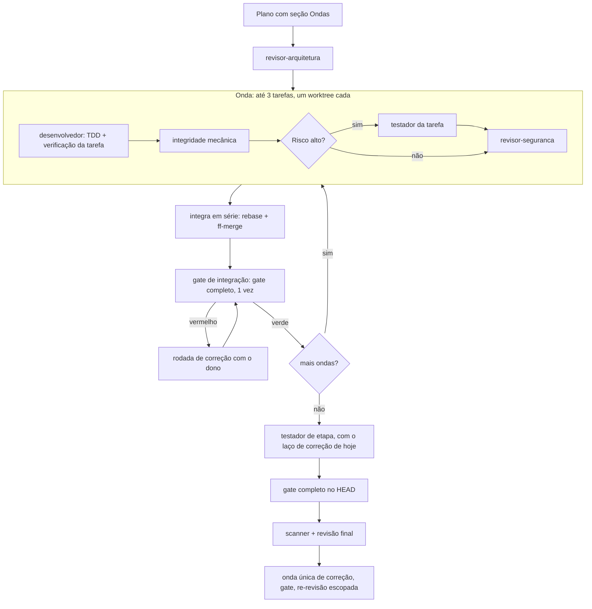

# Souls — desempenho da execução (ondas com fila de integração)

> **Superado em 2026-11-17 por [`DESIGN-enxuto.md`](DESIGN-enxuto.md).** O ciclo de ondas, o testador por tarefa em `Risco: alto`, os campos `Estimativa:` e `Risco:`, a seção `## Ondas` e o gate por onda saíram. Continuam valendo, deste documento: a verificação da tarefa no lugar da suíte inteira, o gate do projeto rodado pelo orquestrador, a lista fechada de riscos, a entrevista de abertura do lote e a regra de espera com prazo. O corpo abaixo fica como registro.

> **Nota (2026-11-17):** design aprovado pelo usuário em 2026-11-17; o corpo abaixo é o texto aprovado e não foi reescrito. A fonte da verdade são as souls em `agents/`. O que a implementação corrigiu ou acrescentou:
> - a contagem de execuções do gate usada como "Hoje" (172 numa sessão, ~4,6 por tarefa) era subcontagem. Com o `medir_sessao.py`, a mesma sessão tem 227 execuções de `./gradlew build` (6,1 por tarefa), e quatro sessões anteriores ao ADR 0011 ficam entre 4,4 e 6,4 por tarefa. O alvo de ≤ 1,5 não muda;
> - o script conta como gate só o comando que de fato o executa, não a menção em texto ou heredoc;
> - o gate de integração roda também depois da onda única de correção de cada etapa, para o resíduo aparecer;
> - a cópia de preservação `99 System/Souls/medir_sessao.py` foi para `agents/scripts/medir_sessao.py`;
> - a revisão final da branch acrescentou: sem a linha `gate do projeto`, o gate é o comando de build ou validação completa do `CLAUDE.md` (a suíte inteira mais o lint só na falta dele); nem a suíte inteira roda por tarefa, mesmo que o prompt implementer a peça; gate vermelho no teto de 5 rodadas ou sem dono deixa a etapa `#bloqueada`; plano antigo sem `## Ondas` roda como ondas de uma tarefa só; o `revisor-arquitetura` barra tarefa na mesma onda que a sua dependência ou fora de qualquer onda;
> - depois da Medição 1 (`MEDICOES-desempenho.md`), entrou a regra de espera com prazo: `timeout` em todo comando de teste, build, lint e gate, nenhum laço de espera nem processo solto, e teto de 20 min para o orquestrador conferir um subagente sem entrega. Ela cobre o item "Vigia para quedas de serviço" da §9 só no caso de subagente parado; queda do serviço continua sem vigia.

Status: aprovado pelo usuário em 2026-11-17. Criado em 2026-11-17, a partir da medição de cerca de 20 sessões do orquestrador (4 a 17/11/2026, repositórios ZenyHotelManager e ZenyHotelManager-DesktopFront) e de uma pesquisa de práticas publicadas. Complementa o [design das souls](DESIGN.md) e o [design do arquiteto](DESIGN-arquiteto.md); o que lá vale continua valendo, salvo o que este documento muda.

Marcadores: **[usuário]** indica decisão do usuário; **[agente]** indica escolha do agente que escreveu o design, revisável pelo usuário. Números sem marcador são medições dos transcritos (`~/.claude/projects/`), com os limites descritos na §7.

## 1. Intenção

Uma rodada do orquestrador que conclui 3 ou 4 etapas leva hoje de 12 a 14 horas, e o avanço pelo roadmap fica lento. **[usuário]** quer a mesma rodada em 4 a 6 horas, com o código ainda bom.

A medição mostrou onde o tempo vai:

| Medida | Valor |
|---|---|
| Espera de build e teste (Gradle e `tests/run.sh`) | 60–70% do tempo dos agentes |
| Modelo (API) | cerca de 30% |
| `revisor-seguranca` | 1–2 min por despacho, 3–5% da sessão |
| `revisor-arquitetura` | 10–40 min por sessão |
| Orquestrador sozinho | 8–10% |
| Paralelismo real (soma do tempo dos agentes ÷ tempo de relógio com agente ativo) | 1,0–1,2× na maioria das sessões |

As causas:

1. **O gate completo roda dentro do laço de cada agente.** Numa sessão de 37 tarefas, `./gradlew build` rodou 172 vezes e `tests/run.sh` 170: quase 5 gates por tarefa. Cada build leva de 2 a 7 minutos, embora os 1.028 testes do DesktopFront somem 65 segundos de execução. As souls pedem isso hoje: o desenvolvedor roda a suíte inteira antes do DONE e de cada rodada, o testador roda a suíte inteira no final, e o orquestrador roda de novo por onda e por etapa.
2. **O testador roda em quase toda tarefa** (16 de 16, 14 de 15) e custa de 50% a 80% do tempo do desenvolvedor. A regra de `Risco: alto` inclui "contrato público" e "o núcleo que a etapa existe para entregar", e com isso quase tudo sai `alto`.
3. **As ondas paralelas quase nunca se formam.** Os planos saem como cadeias de tarefas dependentes.
4. **O lote para esperando o usuário.** Cinco sessões ficaram de 1 a 9 horas presas numa chamada de `AskUserQuestion`.

A sessão do DesktopFront sob o ADR 0011 (16/11) é o dado real mais próximo do alvo: com testador por etapa e ondas, fez a E03 (11 tarefas) em 2,5 h e a E04 (13 tarefas) em 2,0 h, com paralelismo de 2,0×. Ela também retirou a `revisor-seguranca`, que este design mantém: a revisora custa poucos minutos por tarefa e não era a causa da lentidão.

## 2. Objetivos, não-objetivos e anti-objetivos

**Objetivos**

1. Uma rodada de 3 a 4 etapas em 4 a 6 horas de relógio, sem contar a espera pelo usuário. **[usuário]**
2. Qualidade mantida **[usuário]**, o que este design traduz em quatro garantias **[agente]**:
   - toda tarefa continua revisada pela `revisor-seguranca` antes de ser integrada;
   - todo o código da etapa continua atacado pelo `testador` antes de a etapa fechar;
   - a verificação mecânica de integridade dos testes continua por tarefa e por etapa;
   - nenhum commit chega à branch principal sem o gate completo do projeto verde no HEAD que entra.
3. As regras continuam neutras de stack: as souls servem a qualquer projeto, e o que é específico (comandos, gate) fica no `CLAUDE.md` de cada um.

**Não-objetivos (desta versão)**

- Trocar a divisão por papéis pelo desenho de um construtor por etapa com avaliador no fim, descrito pela Anthropic. **[usuário]** decidiu não fazer agora.
- Mudar o tamanho das tarefas (até ~45 min e 3 arquivos de produção), o limite de 5 rodadas de correção ou a revisão do plano. Ficam como estão, para que o efeito das mudanças abaixo possa ser medido isoladamente. **[agente]**
- Alterar `soul_guard.py`, `check_test_integrity.py`, as ferramentas de cada soul ou o plugin superpowers.
- Ajustar o build de cada projeto (cache, daemon, memória). É trabalho de cada repositório, listado na §6.

**Anti-objetivos**

- Ganhar tempo retirando revisão ou teste independente.
- "Verde" definido só pelos testes que o agente escolheu rodar. O verde de uma etapa é o gate do projeto, rodado pelo orquestrador sobre o código integrado.
- Tarefa ou etapa fechada sem evidência.

## 3. Abordagens consideradas

| Abordagem | O que muda | Estimativa para 3–4 etapas | Por que sim ou não |
|---|---|---|---|
| A. Ajuste fino | Gate só na integração, testador por etapa | 7–8 h | Baixo risco, mas não chega à meta: continua em série. |
| **B. Ondas com fila de integração** | A, mais planos escritos para ondas e decisões antecipadas | 4–6 h | **Escolhida [usuário].** Chega à meta mantendo os papéis e as travas. |
| C. Trilhas paralelas ou controlador determinístico | Vários orquestradores, ou um script de workflow no lugar do orquestrador | Maior | Limitada pela memória da máquina (14 GB) e exige redesenho do orquestrador. Fica para depois. |

As estimativas de A e B são projeções a partir dos componentes medidos; o único dado real de B é a sessão do ADR 0011.

## 4. Visão geral do fluxo de uma etapa

O que muda em relação a hoje: o gate completo sai de dentro dos agentes e passa a rodar uma vez por ponto de integração; o testador passa a ser por etapa, salvo lista fechada de riscos; o plano nasce dividido em ondas; e a pergunta ao usuário deixa de travar o lote.

## 5. O desenho

### 5.1 Verificação em dois níveis

**Verificação da tarefa (desenvolvedor e testador).** Enquanto itera, o agente roda o teste focado. Antes do DONE e de devolver cada rodada, roda a verificação da tarefa, que tem um contrato único **[agente]**:

- os testes dos arquivos que a tarefa tocou e dos módulos que usam o que mudou, mais a compilação e o lint desses módulos. Só compilação e lint não bastam;
- a linha "verificação rápida" da tabela de comandos do `CLAUDE.md` do projeto diz como fazer isso naquele stack. É uma forma de comando com parâmetro (módulo, filtro de teste), não um comando fixo. Sem a linha, o agente monta o comando a partir das linhas de teste e lint;
- vale igual para o testador por tarefa. O testador de etapa aplica o mesmo contrato ao diff da etapa: roda os testes dos módulos que a etapa tocou;
- o agente não roda o gate completo do projeto. O relatório traz o comando e a saída real.

**Gate de integração (orquestrador).** O gate é a linha "gate do projeto" do `CLAUDE.md` (o orquestrador já a usa hoje; sem ela, vale a suíte inteira). Ele roda completo, na branch da etapa, só nestes pontos **[agente]**:

1. depois de integrar cada onda de duas ou mais tarefas;
2. para ondas de uma tarefa só, depois de acumular até 3 tarefas integradas sem gate, ou antes da próxima onda de duas ou mais, o que vier primeiro;
3. depois do testador de etapa e antes da revisão final, reaproveitando a saída se o HEAD não mudou;
4. depois da onda única de correção e antes do merge na principal.

A onda seguinte só é despachada com o gate verde. Uma tarefa com revisão limpa está integrada; a onda só está fechada com o gate verde.

**Gate vermelho.** Nos pontos 1 a 3, o orquestrador identifica a tarefa dona da falha pelo arquivo do teste ou do erro (`git log` no intervalo da onda). Se isso não basta, roda o gate nos limites das tarefas integradas, que são commits em série na branch da etapa. A correção volta ao desenvolvedor dono como rodada de correção na branch da etapa e conta no limite de 5 rodadas daquela tarefa. No ponto 4 vale a regra de hoje, sem mudança: o vermelho que sobra depois da onda única de correção vira resíduo, a etapa não fecha `#concluida` e o lote não entra na principal com vermelho.

**Por que a qualidade se mantém.** Hoje o "suíte inteira verde" de cada tarefa é o que o agente relata. Com este desenho, o verde é produzido pelo orquestrador sobre o código já integrado, que é o estado que importa. O que se perde: uma quebra fora da área da tarefa aparece no gate da onda, e não dentro da tarefa; o custo é uma rodada de correção e a identificação do dono.

### 5.2 Testador por etapa, por tarefa só em lista fechada

- **Por etapa (padrão):** uma vez, sobre `MERGE_BASE..HEAD`, cobrindo todas as tarefas.
- **Por tarefa:** só quando a tarefa é `Risco: alto`, e `alto` passa a ser uma lista fechada **[agente]**: autenticação ou autorização; dado pessoal ou segredo; cálculo de valor monetário; migração ou escrita destrutiva de dados; concorrência; parsing de entrada externa não confiável. Saem da lista "contrato público" e "o núcleo que a etapa existe para entregar".
- O plano cita, em cada tarefa `alto`, o critério da lista que a justifica.
- O `revisor-arquitetura` confere os dois lados: `normal` em tarefa que toca um item da lista continua achado Importante; `alto` sem critério da lista passa a ser achado Importante também.
- As lacunas de teste que a revisora aponta continuam indo ao testador, só para aquela lacuna.

**A ordem do fim da etapa não muda [agente].** O testador de etapa roda antes da revisão final, como hoje, e seus testes vermelhos seguem o laço de correção de hoje (subpasso 3 do ciclo, até 5 rodadas, com a verificação mecânica desde `MERGE_BASE`). Só depois vêm o gate, o scanner e a revisão final, que assim enxerga os testes do testador de etapa. A onda única de correção e a regra do resíduo ficam como estão. Rodar o testador de etapa em paralelo com a revisão final economizaria uns 15 a 20 minutos por etapa, mas criaria testes que a revisão final não vê; fica para depois (§9).

**Por que a qualidade se mantém.** A cobertura é a mesma: todo o código da etapa passa pelo testador antes do fechamento, e a revisão final vê o resultado. O que muda é o momento. Hoje o testador ataca quase toda tarefa logo depois dela; com este desenho, o testador de etapa passa a ser o primeiro ataque independente à maioria das tarefas. Teste vermelho no fim da etapa deixa de ser raro, e o defeito aparece depois de outras tarefas terem sido construídas em cima. O laço de correção do fim da etapa vai rodar mais vezes do que hoje, e parte do tempo ganho por tarefa volta ali. As categorias em que um defeito tardio custa mais caro continuam com testador por tarefa.

### 5.3 Planos escritos para ondas

- O plano ganha a seção `## Ondas`: a lista de ondas na ordem, com as tarefas de cada uma. Quando várias tarefas precisam do mesmo contrato ou interface, ele vai numa tarefa da primeira onda.
- `Depende de:` só quando a tarefa usa um símbolo ou arquivo que a outra cria. Ordem de preferência não é dependência.
- Tarefas da mesma onda têm arquivos disjuntos, contando testes, fixtures, configuração de build e locks (regra que já existe).
- O `revisor-arquitetura` passa a tratar como achado Importante a dependência declarada sem uso real e a ausência da seção `## Ondas`.
- O limite continua em 3 tarefas por onda, e o prompt pode baixá-lo. O limite vem da memória da máquina, não do desenho.
- A revisora de cada tarefa é despachada assim que a tarefa fica verde, sem esperar as outras da onda. A integração continua só com revisão limpa, em série e na ordem do plano.

### 5.4 Decisões sem parar o lote

- **Entrevista de abertura do lote.** Antes da primeira etapa, o orquestrador lê as seções das etapas que cabem no limite do lote e as "Hipóteses e decisões em aberto" do roadmap. O que for decisão de arquitetura já previsível vira uma única entrevista, no início, enquanto o usuário está presente. (O nome evita confusão com o "pré-voo" do superpowers e com o pré-voo do servidor do DesktopFront.)
- **Durante o lote.** Decisão de arquitetura que surge no meio não vira chamada bloqueante enquanto houver trabalho elegível. O orquestrador registra a pergunta no handoff, já em forma de entrevista com opção recomendada, segue nas tarefas que não dependem dela e, se a etapa não anda sem a resposta, marca `#bloqueada` e passa para a próxima etapa elegível.
- **A entrevista acontece** quando nada mais anda ou no fim do lote.
- As paradas que são do usuário por definição (etapa com Revisão humana: sim, push, deploy, instalação, segredo exposto) não mudam.

### 5.5 O que não muda

- A revisão do plano pelo `revisor-arquitetura`, com até 2 rodadas.
- A revisão de cada tarefa pela `revisor-seguranca` e a revisão final no modelo mais capaz.
- A verificação mecânica por tarefa e por etapa, e a conferência de cada despacho (trailers, `git status` limpo).
- As travas de cada soul, o ledger e as regras de rodada de correção do superpowers.
- O método do arquiteto e a estrutura do roadmap.

## 6. Arquivos afetados

**No vault (escopo deste design)**

| Arquivo | Mudança |
|---|---|
| `agents/orquestrador.md` | Passo 1 (lista fechada de `Risco: alto`, seção `## Ondas`), passo 3 (testador por tarefa só em `alto`), passo 3a (gate de integração, gate vermelho), passo 5 (testador de etapa sobre todas as tarefas; gate depois dele), "Decisões" e "Quando paro e pergunto" (entrevista de abertura e pergunta que não bloqueia). O corpo tem hoje 108 linhas e o teste limita a 120: o texto precisa ser reescrito de forma compacta, não só acrescido. |
| `agents/desenvolvedor.md` | "Como trabalho" item 2 e "Como entrego": verificação da tarefa no lugar da suíte inteira. |
| `agents/testador.md` | "Quem sou" e "Como trabalho" item 5: os três casos de despacho e a verificação da tarefa no lugar da suíte inteira. |
| `agents/revisor-arquitetura.md` | "Como trabalho" item 3: os achados novos de forma do plano (§5.2 e §5.3). |
| `agents/revisor-seguranca.md` | "Como trabalho": na revisão de tarefa, a evidência de teste é a verificação da tarefa; a saída do gate completo vem no pacote da revisão final. |
| `README.md` (Souls) | Tabela das souls e seção "Como usar", onde descrevem o ciclo. |
| `agents/scripts/medir_sessao.py` (novo) e teste em `tests/` | O script de medição (§7), a partir da cópia de preservação em `99 System/Souls/medir_sessao.py`, que sai de lá. |
| Skill `development-roadmap` | `references/brain.md`: a tabela de comandos do `CLAUDE.md` enxuto passa a prever duas linhas nomeadas além de build, teste e lint: "verificação rápida" (forma de comando com parâmetro, §5.1) e "gate do projeto". `SKILL.md`: a etapa inicial de projeto sem código registra também essas duas. O protocolo do template já remete ao orquestrador e, pela leitura feita, não precisa mudar; o construtor confirma. |
| `20 Knowledge/Souls - alma personalizada para cada agente de desenvolvimento.md` | Registro curto da mudança, com proveniência desta sessão. |

**Em cada projeto (fora deste design; cada um na própria sessão do repositório)**

1. Acrescentar a linha "verificação rápida" à tabela de comandos do `CLAUDE.md`. Sem ela, vale a regra geral dos testes da área.
2. Avaliar um gate que pule o que a mudança não afeta (no DesktopFront, o `tests/run.sh` consumiu cerca de 3 horas numa sessão, quase sempre sem nenhum `.sh` alterado). O gate antes do merge na principal continua completo.
3. Medir o build com `--profile` e avaliar build cache, configuration cache e o tempo de vida do daemon. Hoje os dois projetos não usam cache, e o daemon do DesktopFront encerra depois de 3 minutos ocioso.
4. No DesktopFront, revogar o ADR 0011 é decisão do usuário. Com este desenho, a exceção deixa de ser necessária, e a revisão adiada de `a300a23..HEAD` precisa ser paga.

## 7. Medição e critérios de sucesso

O script que gerou os números de tempo e paralelismo desta análise está preservado, sem alteração, em `99 System/Souls/medir_sessao.py` (cópia do `timeline2.py` do scratchpad da sessão de 2026-11-17). Ele passa a morar em `agents/scripts/medir_sessao.py` **[agente]**, para estar disponível em toda máquina configurada. Ele lê o transcrito de uma sessão e de seus subagentes e atribui cada intervalo a API, ferramenta, espera de tarefa em segundo plano ou ocioso. O construtor parte dessa cópia, para que os números novos sejam comparáveis com os da coluna "Hoje".

O que o script já calcula e o que falta:

| Medida | Definição | Estado |
|---|---|---|
| Relógio sem a espera pelo usuário | Tempo da sessão menos o tempo com nada rodando e menos o tempo em `AskUserQuestion` | Calcula as parcelas; falta a linha com a subtração |
| Paralelismo | Soma do tempo ativo dos subagentes ÷ união desses intervalos | Calcula |
| Tarefas | Número de agentes `desenvolvedor` distintos na sessão (o ledger é apagado no fim da etapa) | Calcula |
| Execuções do gate por tarefa | Comandos de shell, em qualquer fluxo, que casam com o padrão de gate ÷ tarefas | Falta. O número de hoje veio de uma contagem avulsa numa sessão de 37 tarefas: 172 `./gradlew build` |
| Tarefas com testador por tarefa | Agentes `testador` ÷ agentes `desenvolvedor` | Falta a linha |

Os padrões de build e de gate viram parâmetros do script, com os valores atuais (Gradle, pytest, Node, `tests/run.sh`) como padrão **[agente]**: o script mora junto das souls, que são neutras de stack.

A contagem de achados da revisão final não sai do script. Ela vem da seção "Evidências e handoff" de cada etapa no roadmap, que já registra o resultado da revisão final (por exemplo, "0 Critical e 1 Important").

Limites da medição: a atribuição vem dos carimbos de tempo dos transcritos; os comandos são classificados por expressão regular; a fatia de build é um piso, porque esperas indiretas ficam fora.

Nas duas primeiras rodadas depois da mudança, nos mesmos repositórios:

| Critério | Hoje | Alvo |
|---|---|---|
| Relógio de uma rodada de 3–4 etapas, sem a espera pelo usuário | 12–14 h | 4–6 h |
| Paralelismo nas etapas com ondas | 1,0–1,2× | ≥ 1,5× |
| Execuções do gate completo por tarefa | ~4,6 (uma sessão) | ≤ 1,5 |
| Tarefas com testador por tarefa | ~100% | ≤ 1/3 |
| Etapas fechadas sem revisão final limpa | 0 | 0 |
| Achados Críticos e Importantes da revisão final por etapa, e resíduos | os handoffs das etapas já concluídas | não piora |

Se o último critério piorar, a primeira reação é devolver à lista de `Risco: alto` a categoria em que os defeitos tardios apareceram. Reverter tudo é um `git revert` do commit das souls.

## 8. Riscos

| Risco | Resposta do desenho |
|---|---|
| Defeito achado mais tarde: o testador de etapa passa a ser o primeiro ataque à maioria das tarefas, e o laço de correção do fim da etapa roda mais | A lista fechada mantém o testador por tarefa onde o defeito tardio é caro; o laço de até 5 rodadas e a regra do resíduo não mudam; o critério de sucesso mede achados e resíduos. |
| Verificação da tarefa deixa passar quebra em outro módulo | O gate de integração roda sobre o código integrado antes de qualquer onda seguinte. |
| Gate vermelho com dono difícil de identificar | Commits da onda são em série; o orquestrador roda o gate nos limites das tarefas. |
| A classificação de risco passa a sair toda `normal` | O `revisor-arquitetura` mantém o achado Importante para `normal` em tarefa que toca a lista. |
| Ondas de 3 builds estouram a memória | Limite de 3 mantido e redutível no prompt; no despacho, cada tarefa recebe a fração de núcleos (regra que já existe). |
| Corpo do orquestrador passa de 120 linhas | Reescrita compacta; o teste `test_souls_files.py` barra. |
| Etapa `#bloqueada` por pergunta que o usuário responderia em um minuto | A entrevista de abertura do lote antecipa as perguntas previsíveis. |

## 9. Deixado para depois

- Despachar a onda seguinte enquanto o gate da anterior roda.
- Rodar o testador de etapa em paralelo com a revisão final.
- Tarefas maiores e em menor número; teto de rodadas de correção abaixo de 5; revisão de plano só em etapas que tocam ADR, contrato ou persistência.
- Um construtor por etapa com avaliador no fim (desenho da Anthropic), como experimento medido.
- Vigia para quedas de serviço: em 16/11 o lote ficou 3 horas parado por falha do classificador do auto mode, até o usuário escrever "retome".
- Mais memória na máquina, que é o que limita o tamanho das ondas.

## 10. Restrições

- Seguir a política de mutação do vault. Commit só com a concordância do usuário. Nunca `push`.
- Não duplicar regras: as regras de encaixe das souls no ciclo do superpowers continuam só em `orquestrador.md`.
- Regras neutras de stack; nenhum comando de projeto dentro das souls.
- Os testes existentes (`python3 -I -m unittest discover -s "99 System/Souls/tests"`, `test_sync_souls.sh` e os da skill `development-roadmap`) continuam passando.

## 11. Deixado para o construtor

- O texto exato de cada soul, dentro dos limites da §5 e da anatomia de seis seções.
- Como o orquestrador roda o gate sem bater no tempo limite da ferramenta de shell (muitos comandos de hoje terminam exatamente em 180 s e são repetidos): em segundo plano, com uma única espera.
- A forma da seção `## Ondas` no plano e as linhas novas do ledger (gate de integração, dono do vermelho).
- As medidas que faltam no script (§7), seus parâmetros e o teste dele.
- Conferir se `references/template.md` e `check_roadmap.py` precisam de ajuste.

## Fontes

- Medição: transcritos de `~/.claude/projects/-home-caio-repos-ZenyHotelManager*` (4 a 17/11/2026).
- Captura `2026-11-16 - ZenyHotelManager-DesktopFront - ADR 0011 processo acelerado até a demo - 0cc1844e` (Inbox).
- Anthropic, "Building multi-agent systems: when and how to use them": https://claude.com/blog/building-multi-agent-systems-when-and-how-to-use-them
- Anthropic, "Harness design for long-running application development": https://www.anthropic.com/engineering/harness-design-long-running-apps
- Superpowers 7.0.2, `subagent-driven-development` (`SKILL.md`, `references/fix-loop.md`, `references/final-review.md`) e `RELEASE-NOTES.md`, na cópia local do plugin.
