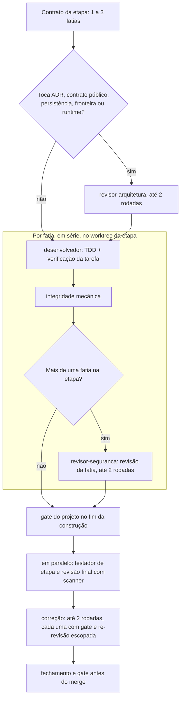

# Souls — ciclo enxuto (contrato, fatias e avaliação no fim)

Status: aprovado pelo usuário em 2026-11-17, que delegou ao agente a forma final ("pode ser como você recomendar"). Substitui o ciclo de ondas de [`DESIGN-desempenho.md`](DESIGN-desempenho.md). O que os designs anteriores dizem sobre anatomia, travas, sincronização e testes das souls continua valendo. A fonte da verdade são as souls em `agents/`.

Marcadores: **[usuário]** indica decisão do usuário; **[agente]** indica escolha do agente que escreveu o design, revisável pelo usuário. Números sem marcador são medições dos transcritos de `~/.claude/projects/-home-caio-repos-ZenyHotelManager*` (4 a 17/11/2026).

## 1. Intenção

A Medição 1 ([`MEDICOES-desempenho.md`](MEDICOES-desempenho.md)) mostrou que o ciclo de ondas cumpriu o que mirava (0,64 gate por tarefa, nenhum build completo rodado por agente), mas a rodada levou 9h00 para duas etapas: 2h39 de travamento e, no resto, cerca de 3h10 por etapa, contra a meta de 1 a 2 horas.

Uma análise feita em outra sessão recomendou um modelo enxuto, inspirado no desenho planejador → construtor → avaliador da Anthropic. **[usuário]** pediu que ela fosse avaliada contra os dados e implementada se se sustentasse. A avaliação aceitou a maior parte, rejeitou dois pontos e ajustou três. Este documento registra a forma final.

## 2. O que os dados dizem

| Pergunta | Dado |
|---|---|
| Quanto custa o arranque a frio de um desenvolvedor por tarefa? | Cerca de 1,5 min por agente; 18 min na Medição 1 inteira (11 desenvolvedores) |
| Quanto as ondas economizaram? | Na E06, 40 min de construção (1h25 em série, 45 min em paralelo); na E05, 23 min |
| Por que a janela das ondas da E06 levou 2h01? | 49 min de ataques do testador por tarefa em série, cerca de 22 min de gates entre ondas e 11 min de revisões |
| A revisão por tarefa acha coisa? | Abriu rodada de correção em 56 de 122 tarefas (46%; de 29% a 71% por sessão) |
| E a revisão só no fim? | Nas 24 tarefas feitas sem revisão por tarefa (M3 E03 e E04), as revisões do fim acharam 0 Críticos, 2 Importantes e 27 Menores |
| Quanto custa a revisão do plano? | 8m38 por plano em média; 40 dos 41 primeiros pareceres bloquearam |
| Quantos desenvolvedores passam de 2 retomadas? | 23 de 343 (7%) |
| Um subagente aguenta uma etapa inteira? | Nenhum dos 1.102 subagentes medidos compactou contexto; o maior chegou a 398 mil tokens. Uma tarefa acrescenta de 40 a 70 mil; uma etapa de 8 tarefas somaria de 400 a 600 mil |
| Quanto leva o testador de etapa? | Mediana de 11 min em 18 despachos; 4 passaram de 28 min, o maior com 52 min |

Limite: não dá para contar o que a revisão final "não pegaria". O dado só mostra que a revisão do fim não reproduz o volume de achados da revisão por tarefa.

## 3. Objetivos, não-objetivos e anti-objetivos

**Objetivos**

1. Reduzir o relógio por etapa de cerca de 3h10 para cerca de 2h35, sem contar travamento nem o gate mais rápido de cada projeto. É projeção, não medida. **[agente]**
2. Manter as garantias de qualidade: todo código revisado por agente independente antes de entrar na principal, todo código da etapa atacado pelo testador, integridade mecânica dos testes, gate do projeto verde no HEAD que entra. **[usuário]**
3. Menos regra própria nas souls: o ciclo continua sendo o `superpowers:subagent-driven-development`, com fatias no lugar das tarefas pequenas. **[agente]**

**Não-objetivos**

- Gate mais rápido em cada projeto (cache, gate sensível à mudança): é trabalho de cada repositório.
- Mudar `soul_guard.py`, `check_test_integrity.py`, as ferramentas ou os hooks de qualquer soul.
- Paralelismo entre fatias. Pode voltar depois, se a medição mostrar que vale.

**Anti-objetivos**

- Ganhar tempo tirando revisão independente ou o testador.
- Um desenvolvedor carregando uma etapa inteira num contexto só, além do que já foi observado funcionando.

## 4. Abordagens consideradas

| Abordagem | O que é | Por que sim ou não |
|---|---|---|
| Manter as ondas e só tirar o testador do caminho crítico | Ondas de até 3 tarefas, testador no fim | Mantém a máquina de worktree por tarefa, rebase e dono do gate vermelho, e os laços de espera entre agentes paralelos que prenderam a Medição 1 |
| Recomendação original | Um desenvolvedor por etapa, avaliação só no fim, ciclo próprio no lugar do SDD | Rejeitada em dois pontos: sem revisão intermediária (46% das tarefas têm achado) e contexto de etapa inteira num subagente (nunca observado) |
| **Contrato com fatias (escolhida)** | 1 a 3 fatias por etapa, um desenvolvedor por fatia em série, revisão por fatia quando há mais de uma, testador e revisão final em paralelo no fim | Fica com a maior parte do ganho e mantém o SDD, a revisão intermediária e um contexto por fatia do tamanho já observado |

## 5. O desenho

### 5.1 Plano como contrato da etapa

- O plano traz de 1 a 3 fatias verticais. Cada fatia é uma tarefa do plano (`### Task N`), para os scripts do SDD continuarem servindo.
- Cada fatia traz `Objetivo`, `Critérios de aceite` (cada um com o comando ou o teste que o confere), `Áreas tocadas`, `Tamanho:` (minutos de construção e arquivos de produção previstos), `Depende de:` e as interfaces que outra fatia consome. Sem código e sem passo a passo.
- Uma fatia cabe num contexto: a que passaria de cerca de 60 min de construção ou de 12 arquivos de produção é dividida. **[agente]** O número vem dos dados: 13 min e até 3 arquivos por tarefa de hoje, e de 4 a 5 tarefas por contexto dentro do que já foi observado. O campo `Tamanho:` existe para o teto poder ser conferido.
- O orquestrador confere a forma do contrato antes de commitar o plano, pelos mesmos itens que o `revisor-arquitetura` confere, porque nas etapas dispensadas ninguém mais a veria.
- Plano fora deste formato (recebido pronto ou escrito no ciclo anterior) não é reescrito: cada tarefa restante vira uma fatia, em série, com revisão de fatia.
- O cabeçalho traz `Riscos:` com os itens da lista fechada que a etapa toca. A lista não muda: autenticação ou autorização; dado pessoal ou segredo; cálculo de valor monetário; migração ou escrita destrutiva de dados; concorrência; parsing de entrada externa não confiável. Ela deixa de decidir o testador por tarefa e passa a dirigir o ataque do testador de etapa.
- Saem os campos `Estimativa:` e `Risco:` por tarefa, a seção `## Ondas` e o limite de 45 min ou 3 arquivos.
- O orquestrador usa o `superpowers:writing-plans` pelo cabeçalho (Goal, Spec, Global Constraints, Review Focus), pelo bloco Interfaces e pela autorrevisão. No lugar dos passos com código, cada tarefa é uma fatia com os campos acima. É um desvio declarado da skill, não um ciclo novo. **[agente]**

### 5.2 Revisão de arquitetura quando a etapa exige

- É obrigatória quando a etapa cria ou contraria decisão de ADR ou ARCHITECTURE, muda contrato público (API, DTO, schema, formato persistido), persistência ou migração, fronteira de módulo ou serviço, ou traz peça nova de runtime.
- Fora disso, o orquestrador a dispensa e grava no plano a seção `## Revisão de arquitetura` com "dispensada" e o que conferiu, e a linha `Plano: dispensada (<motivo>)` no ledger. Na dúvida, a revisão é obrigatória.
- A `revisor-seguranca` confere a dispensa contra o diff na revisão final: dispensa em etapa que tocou um desses pontos bloqueia. **[agente]** Sem essa conferência, o orquestrador julgaria sozinho se precisa ser revisado. Ela confere também se `Riscos:` cobre o que o diff toca.
- Se a revisão final bloquear por dispensa indevida, ou se a etapa passar a tocar um desses pontos durante a execução, o orquestrador despacha o `revisor-arquitetura` sobre o plano e leva o resultado à re-revisão escopada.

### 5.3 Um desenvolvedor por fatia, em série

- Um `desenvolvedor` novo por fatia, no worktree da etapa, com TDD, commits pequenos e a verificação da tarefa antes do DONE.
- Saem as ondas, o worktree por tarefa, o rebase e o merge por tarefa e a regra do dono do gate vermelho por onda.
- A conferência de cada despacho (trailer e `git status`) fica. Passa de dezenas para 2 a 6 por etapa e pegou dois erros de trailer na Medição 1.
- A verificação mecânica roda a cada fatia e na etapa.

### 5.4 Revisão por fatia

- Etapa de uma fatia só: não há revisão de fatia. A revisão final cobre o mesmo diff, e o ledger registra a fatia como completa com "revisão na revisão final".
- Etapa de duas ou três fatias: a `revisor-seguranca` revisa cada fatia antes da seguinte, como o SDD pede.
- No máximo 2 rodadas de correção por fatia, retomando o mesmo desenvolvedor. O superpowers dá 5 e, no teto, estaciona o achado e segue; aqui as rodadas 4 e 5 e esse estacionamento não valem. No teto com achado aberto, a etapa fica `#bloqueada`.
- Teste faltando apontado na revisão de fatia não abre rodada: entra no despacho do testador de etapa.

### 5.5 Fim da etapa: gate, depois testador e revisão final em paralelo

- O gate do projeto roda completo no fim da construção, depois de cada rodada de correção do fim da etapa e antes do merge na principal, reaproveitado se o HEAD não mudou. São 2 a 3 por etapa.
- Com o gate verde, o orquestrador roda o scanner e a verificação mecânica desde `MERGE_BASE` e despacha ao mesmo tempo o testador de etapa e a revisão final.
- O testador ataca o diff da etapa contra o contrato, começando pelos critérios de aceite e pelos `Riscos:`, com teto de 30 min no despacho. **[agente]**
- Os dois resultados vão juntos a uma rodada de correção, com o desenvolvedor da fatia mais afetada. Depois dela vêm a verificação da tarefa, a integridade, o gate e a re-revisão escopada sobre tudo o que entrou depois do HEAD que a revisão final viu. A re-revisão roda mesmo sem achados, se o testador commitou testes: é assim que os testes dele são revisados.
- No máximo 2 rodadas. O superpowers dá uma rodada só no fim; aqui valem até duas. O que sobrar vira resíduo, e a etapa fica `#bloqueada`.
- Gate vermelho no fim da construção volta ao desenvolvedor da fatia dona do arquivo e conta como rodada. Estouro do limite ou falha de ambiente não vai ao desenvolvedor: o gate roda de novo uma vez.
- Se o desenvolvedor contesta um teste do testador, o orquestrador consulta o testador: teste errado, o testador corrige o próprio teste; teste certo, o desenvolvedor corrige o código. Achado da revisão sobre teste do testador vai ao testador.
- O testador de etapa não é estacionado: sem entrega, é redespachado uma vez; sem entrega de novo, a etapa fica `#bloqueada`. O que ele listar como não atacado vai ao handoff, e critério de aceite ou item de `Riscos:` não atacado gera um redespacho só para isso.

### 5.6 Etapa bloqueada não entra na principal

Etapa `#bloqueada` que deixou código na branch não passou pelo testador de etapa nem pela revisão final, e um achado de revisão aberto não deixa o gate vermelho. Por isso **[agente]**:

- o lote encerra nela, e o merge leva só até o HEAD da última etapa `#concluida`;
- sem etapa concluída, o orquestrador não integra e deixa a branch pronta;
- etapa bloqueada sem código na branch (por pergunta ao usuário antes de construir, por exemplo) não para o lote.

No ciclo anterior isso não precisava ser dito, porque bloqueio sempre vinha com teste vermelho e o gate segurava.

### 5.7 O que não muda

- As travas de cada soul, o `soul_guard.py` e o `check_test_integrity.py`.
- O testador sem acesso ao código de produção e a revisora só de leitura.
- A verificação da tarefa no lugar da suíte inteira, e a regra de espera com prazo.
- O scanner na revisão final, o gate antes do merge, a entrevista de abertura do lote, o ledger do SDD, o `brain-escriba`, o arquiteto e a ausência de push.
- A pré-condição continua na soul do orquestrador. Levá-la a um hook de sessão economizaria menos de um minuto e não foi verificado se é viável.

## 6. Arquivos afetados

| Arquivo | Mudança |
|---|---|
| `agents/orquestrador.md` | Passos 1, 2, 3 e 5 reescritos; sai o passo 3a; "Registro", "Como entrego" e "Quando paro e pergunto" ajustados; descrição do frontmatter |
| `agents/desenvolvedor.md` | Uma fatia por vez, no worktree da etapa; sai a menção à onda |
| `agents/testador.md` | Dois casos de despacho (etapa e lacuna da revisão); contrato da etapa; teto de tempo |
| `agents/revisor-arquitetura.md` | Achados de forma do contrato no lugar dos de onda |
| `agents/revisor-seguranca.md` | Revisão por fatia; conferência da dispensa de arquitetura |
| `README.md` | Tabela das souls e "Como usar" |
| `tests/test_souls_desempenho.py` | Passa a fixar as regras deste ciclo |
| Skill `development-roadmap` | Tabela de papéis e passo "Plano" do `references/template.md`; §4 e §7 do `SKILL.md` |
| `DESIGN-desempenho.md`, `DESIGN.md` | Nota de superado e nota de mudança, sem reescrever o corpo |
| `20 Knowledge/Souls - alma personalizada para cada agente de desenvolvimento.md` | Registro da mudança, com proveniência |

Roadmaps já escritos nos projetos continuam executáveis: o protocolo deles remete as regras do ciclo ao `orquestrador`. A tabela de papéis deles fica com a descrição antiga até serem atualizados pela skill.

## 7. Critérios para a próxima rodada

Nos mesmos repositórios. O `agents/scripts/medir_sessao.py` dá o relógio, as esperas longas, os gates, as fatias (que ele chama de tarefas) e o contexto de pico do desenvolvedor; o número de etapas, as etapas bloqueadas e os achados da revisão final vêm do roadmap e dos handoffs:

| Critério | Medição 1 | Alvo |
|---|---|---|
| Relógio por etapa, sem travamento | 3h10 | cerca de 2h35 |
| Esperas longas em segundo plano | 1 (2h39) | 0 |
| Gates por etapa | 4,5 | 2 a 3 |
| Fatias por etapa | não se aplica | 1 a 3 |
| Contexto de pico de um desenvolvedor | 399 mil tokens no maior | abaixo de 400 mil |
| Etapas `#bloqueada` pelo teto de 2 rodadas | não se aplica | registrar quantas |
| Achados Críticos e Importantes da revisão final por etapa | 0 a 2 | não piora |

Se o contexto de pico passar de 400 mil ou as etapas bloqueadas pelo teto forem frequentes, a primeira reação é baixar o tamanho da fatia. Reverter tudo é um `git revert` do commit deste ciclo.

## 8. Riscos

| Risco | Resposta |
|---|---|
| Fatia grande demais para um contexto | Teto de 60 min ou 12 arquivos; critério de contexto de pico na medição |
| Teto de 2 rodadas bloqueia etapas que 5 rodadas fechariam, e etapa bloqueada com código encerra o lote | 7% dos desenvolvedores passam de 2 retomadas hoje; a medição registra as bloqueadas. Se for frequente, o teto sobe antes de qualquer outra mudança |
| Código de etapa bloqueada chega à principal com gate verde | O merge leva só até a última etapa concluída (§5.6) |
| Orquestrador dispensa a revisão de arquitetura indevidamente | A `revisor-seguranca` confere a dispensa contra o diff |
| Testes do testador de etapa sem revisão | A re-revisão escopada roda sempre que ele commitou |
| Defeito achado só no fim da etapa custa mais | A revisão por fatia pega o que é de código; o testador continua atacando tudo antes do fechamento |
| Perda dos 23 a 40 min que as ondas economizavam por etapa | Compensada pela saída dos ataques por tarefa e dos gates entre ondas do caminho crítico; a medição confere |

## 9. Deixado para depois

- Fatias em paralelo, em worktrees próprios, quando forem disjuntas.
- Revisão da fatia sem bloquear a fatia seguinte.
- Pré-condição do orquestrador num hook de sessão.
- Contagem de comandos com laço de espera no `medir_sessao.py`.

## Fontes

- [`MEDICOES-desempenho.md`](MEDICOES-desempenho.md), Medição 1, e os transcritos citados nela.
- Anthropic, "Harness design for long-running application development": https://www.anthropic.com/engineering/harness-design-long-running-apps
- Anthropic, "Building multi-agent systems: when and how to use them": https://claude.com/blog/building-multi-agent-systems-when-and-how-to-use-them
- Claude Code, "Best practices": https://code.claude.com/docs/en/best-practices (lida em parte; o trecho final veio de resumo)
- Superpowers 7.0.2, `subagent-driven-development` e `writing-plans`, na cópia local do plugin.
